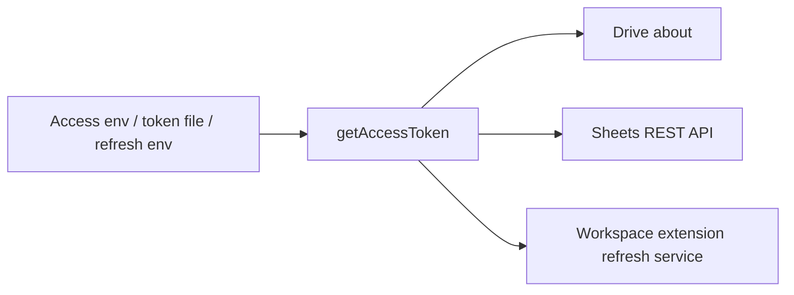

# Google adapters

The only network/storage adapters used by rendering and sign-in. Zero runtime
dependencies; use Node's fetch, filesystem and loopback HTTP server.

| Module | Responsibility |
| --- | --- |
| `auth.js` | Workspace-extension consent URL, loopback/manual login, private token storage, refresh, identity, revocation. |
| `http.js` | Bearer-authenticated JSON calls; at most five attempts on 429/500/502/503/504, with capped exponential backoff. |
| `sheets.js` | Spreadsheet handle, metadata/value reads and chunked formatting/value writes. |



```js
import { getAccessToken } from "./auth.js";
import { sheetsClient } from "./sheets.js";

const token = await getAccessToken();
const client = sheetsClient(spreadsheetId, token);
const meta = await client.get("spreadsheetId,properties(title)");
```

Use `fetchImpl` and `wait` seams in tests. The login callback expires after five
minutes and closes its server; a wrong-domain login is revoked, not stored.
Only Drive scope is requested. Credential priority and environment options are
documented in the root README. No Google client secret is held here.

`writeValues` uses `USER_ENTERED` for formulas, but prefixes non-formula strings
with an apostrophe input marker. Google removes that marker and stores the
literal text, preventing signed money/percentages, dates or numeric-looking
labels from being reinterpreted. Strings beginning `=` are deliberate formulas;
numbers and booleans retain their types. See Google's
[ValueInputOption](https://developers.google.com/workspace/sheets/api/reference/rest/v4/ValueInputOption)
and [ExtendedValue](https://developers.google.com/workspace/sheets/api/reference/rest/v4/spreadsheets/other#ExtendedValue)
references for the UI-input parsing contract. Live verification on 2026-10-26
confirmed signed display text remained literal and generated formulas still
calculated across the eight Hanna Andersson report tabs.
