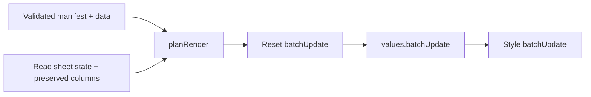

# Render planning and execution

This directory owns the full-render algorithm. It has no Apps Script runtime
and no incremental-render state.

| Module | Responsibility |
| --- | --- |
| `grid.js` | Build rectangular values, resolve named formula references, preserve keyed user columns, and compute primitive layouts. Pure, no I/O. |
| `requests.js` | Build formatting, merge, dimension and grid requests. Convert 1-based coordinates to API GridRanges. |
| `render.js` | `planRender` produces reset/value/style batches; `renderManifest` reads state and executes them. |
| `testing/` | In-memory API, representative fixtures and generated JSON goldens. |



- Reset establishes the declared text formats before values. The client escapes
  literal strings so USER_ENTERED cannot parse signed display text as formulas.
  Style follows values so row resizing measures the written text.
- Writes replace values/formats/merges and conditional rules on rendered tabs.
  Chart steps replace existing charts. Other tabs are not deleted.
- The client in `../google/sheets.js` chunks writes; `../google/http.js` owns
  bounded retries. These batches are not a cross-call transaction: a failed
  publish can leave a reset/partially rendered sheet; retry the publish.

```js
import { renderManifest } from "./render.js";

const result = await renderManifest(manifest, data, { token: accessToken });
console.log(result.tabs, result.warnings, result.calls);
```

## Tests and fixtures

`node --test src/render/` proves values, requests, shorter re-renders,
preservation and chart/rule replacement against an in-memory API. It does not
prove Google's live parsing or chart display.

`testing/fixtures.js` is hand-authored representative data. Only
`testing/golden/*.json` are generated fixtures. Missing goldens fail normally;
regenerate intentionally, then review their diff:

```sh
UPDATE_GOLDEN=1 node --test src/render/render.test.js
```
